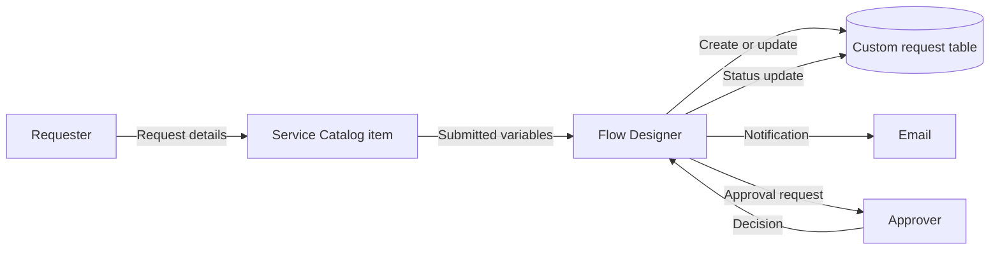

# Data Flow Diagrams and User Stories

## Context-level data flow

## Workflow data flow
1. Requester opens the Network Request catalog item.
2. Requester completes the required catalog variables and submits the item.
3. Flow Designer retrieves the catalog variables.
4. The flow creates a record in the custom request table.
5. The flow sends an email notification.
6. The flow requests approval and evaluates the response.
7. The flow updates the stored approval status.

## User stories
| ID | As a... | I want... | So that... |
|---|---|---|---|
| US-01 | Requester | to submit a network request through the Service Portal | I have one standard entry point |
| US-02 | Requester | to provide requester and connection details | the team receives complete information |
| US-03 | Requester | to see Existing ID only when applicable | the form stays relevant |
| US-04 | Support team | submitted details to be stored in a custom table | request information is traceable |
| US-05 | Approver | to receive an approval request | I can review and decide |
| US-06 | Requester/support team | to receive an email notification | stakeholders are informed |
| US-07 | Support team | the approval decision to update the request record | the stored status reflects the decision |

## Acceptance criteria
- The catalog item is available to the intended test user.
- Required variables are captured and available to the flow.
- The conditional field behaves according to its UI Policy condition.
- A submitted request creates the expected custom-table record.
- The flow executes the notification and approval actions.
- The approval outcome is reflected in the stored record.
