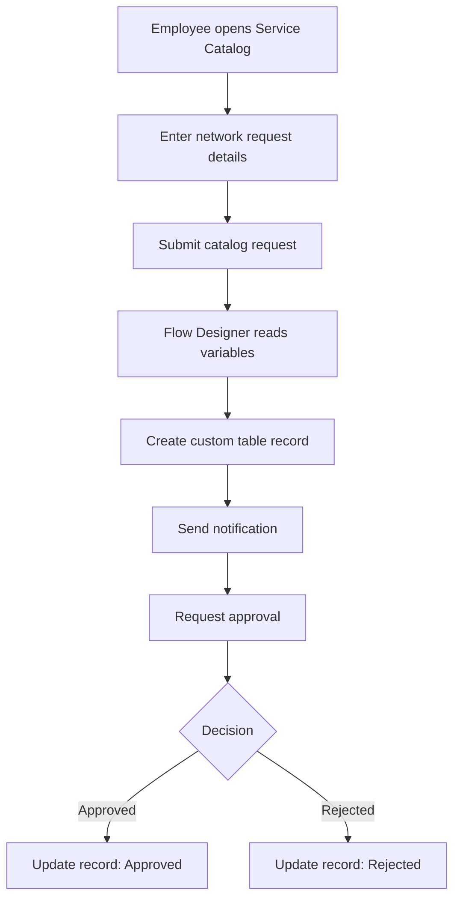

# Data Flow Diagrams and User Stories

## High-level data flow

## User stories
- As an employee, I want a guided catalog form so that I can submit complete request details.
- As a requester, I want user information populated consistently to reduce re-entry.
- As an approver, I want a notification and the ability to approve or reject.
- As support staff, I want request data stored in a dedicated table.
- As a process owner, I want the stored status updated automatically.

## Acceptance criteria
Submitted values are mapped correctly, the custom record is created, notification and approval steps run, and the final status matches the approval outcome.