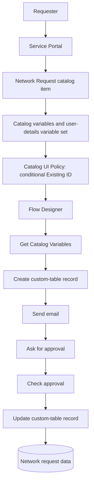

# Solution Architecture

## Architecture overview

## Component responsibilities
| Layer | Component | Responsibility |
|---|---|---|
| Experience | Service Portal | User-facing request submission |
| Intake | Catalog item and variables | Captures request details |
| Form behavior | Variable set and Catalog UI Policy | Reuses user details and controls conditional visibility |
| Orchestration | Flow Designer | Runs the configured workflow |
| Persistence | Custom table | Stores request information and outcome |
| Communication | Email notification | Notifies configured recipients |
| Decision | Approval action | Collects and returns approval decision |

## Data movement
Catalog variables are read by the flow using the Get Catalog Variables step. The values are mapped into the custom-table record. The approval result is evaluated and the record is updated to reflect the configured outcome.

## Design considerations
- Confirm the correct Requested Item reference is used as the flow trigger/input.
- Use data pills from the correct flow steps when mapping values.
- Keep field names and variable names consistent and documented.
- Configure table ACLs and roles for least-privilege access.
- Test approved, rejected, and error paths in the instance.
