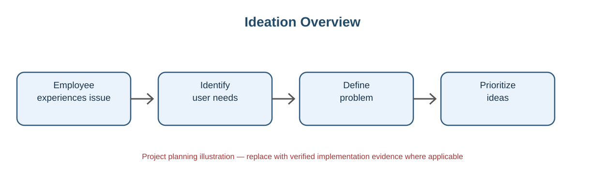

# Define Problem Statements

## Problem Statement
Network service requests can be difficult to track when request details, approvals, notifications and updates are handled manually. A centralized and automated ServiceNow process is needed to improve visibility and reduce repetitive work.

## Key Problems
- Requests may be submitted without consistent information.
- Approval status is not always easy to track.
- Manual record creation increases effort and errors.
- Requesters need timely notifications.
- Administrators need a centralized record of requests.

## Proposed Direction
Use a ServiceNow Catalog Item and Flow Designer automation to standardize request capture, record creation, notification, approval and status update.

---

## Visual Reference

*Figure: Ideation Overview. This is a conceptual project diagram, not a screenshot of a live ServiceNow instance. Add authentic screenshots from the implemented application in the relevant section before final submission.*

## Visual Reference

*Conceptual phase illustration. Add genuine project evidence where required; this image is not a live ServiceNow screenshot.*
