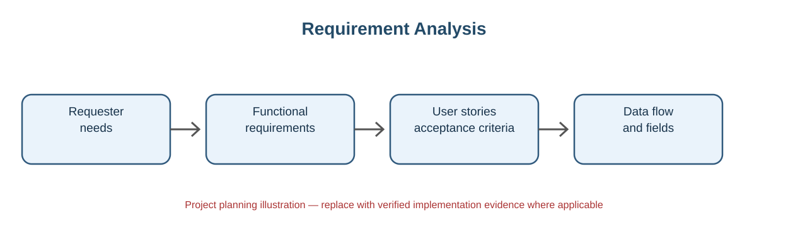

# Hardware and Software Requirements

## Hardware
- Computer or laptop.
- Internet connection.
- Modern web browser.

## Software / Platform
- ServiceNow Personal Developer Instance.
- Web browser such as Chrome or Edge.
- GitHub for project documentation and version control.

The implementation is primarily cloud-based through the ServiceNow PDI.

---

## Visual Reference

*Figure: Requirement Analysis. This is a conceptual project diagram, not a screenshot of a live ServiceNow instance. Add authentic screenshots from the implemented application in the relevant section before final submission.*

## Visual Reference

*Conceptual phase illustration. Add genuine project evidence where required; this image is not a live ServiceNow screenshot.*
