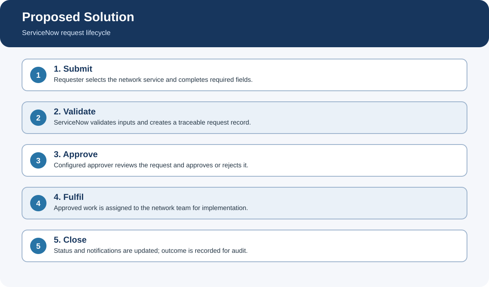

# Proposed Solution

The solution uses ServiceNow Service Catalog and Flow Designer.

### Request Layer
The Network Request catalog item captures Requested For, Mobile Number, Type of Connection, Existing ID, Total Amount, Mode of Payment and Address.

### Logic Layer
A UI Policy controls the Existing ID field based on the connection type. A reusable variable set stores user details.

### Automation Layer
Flow Designer retrieves catalog variables, creates the custom database record, sends an email, asks for approval, checks the approval result and updates the record when approved.

### Outcome
The complete process provides centralized, traceable and automated network request management.

## Visual Reference

*Conceptual design illustration, not a live ServiceNow screenshot. Confirm the final design against the implemented instance.*

## Proposed Solution Visual

