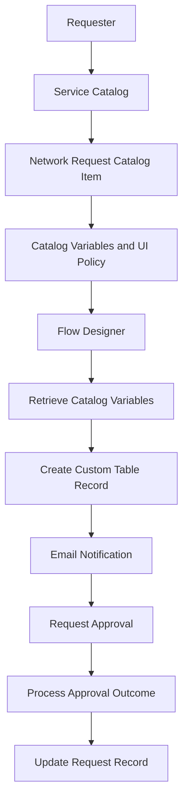
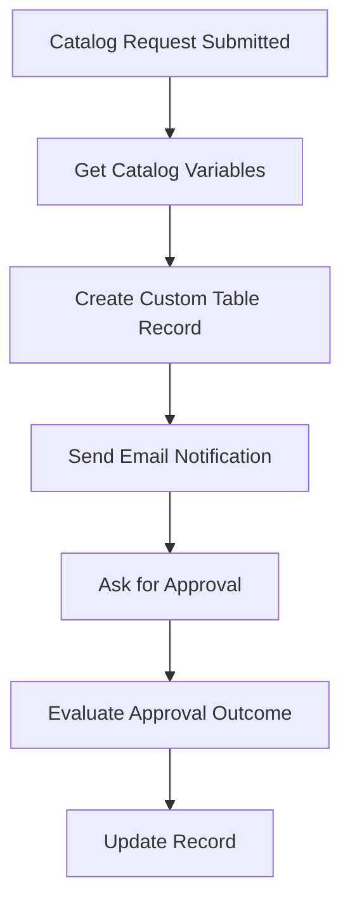

# Final Project Documentation
## Automated Network Request Management in ServiceNow

**Project type:** ServiceNow workflow automation  
**Platform:** ServiceNow Personal Developer Instance (PDI)  
**Primary components:** Service Catalog, Catalog Variables, Variable Set, Catalog UI Policy, Custom Table, Flow Designer, Approvals and Notifications

---

## 1. Abstract

Network connection requests often require users to provide information, administrators to record the details, and approvers to review the request before it is processed. When these steps are handled separately, the process can lead to repeated data entry, delayed communication and difficulty tracking request status.

The **Automated Network Request Management in ServiceNow** project demonstrates a centralized request process using a Service Catalog item and Flow Designer. A requester submits a structured Network Request form. The workflow retrieves the catalog variables, creates a record in a custom table, sends an email notification, requests approval and updates the record based on the configured approval path.

The project illustrates how ServiceNow platform features can be combined to standardize request intake and improve traceability.

## 2. Problem Statement

A network connection request needs a consistent way to collect requester information, store the request, notify the relevant people and record the approval outcome. A disconnected or manual process can make it harder to track requests and maintain consistent information.

The problem addressed by this project is how to organize these activities in one ServiceNow workflow with a structured form, centralized record storage and automated processing.

## 3. Objectives

- Provide a structured Network Request catalog form.
- Collect requester and connection details consistently.
- Show the Existing ID field conditionally using a Catalog UI Policy.
- Store submitted request information in a custom database table.
- Automate the main request-processing steps with Flow Designer.
- Send an email notification as part of the configured workflow.
- Request approval and update the record according to the configured outcome.
- Validate the workflow through a submitted request and Flow Designer execution.

## 4. Scope

### Included in the project
- Network Request catalog item under the Service Catalog.
- Request variables for user, connection and payment details.
- Reusable **Network Request User Details** variable set.
- Conditional visibility for the Existing ID field.
- Custom table record creation.
- Flow Designer automation for variable retrieval, record creation, notification, approval and record update.
- Functional validation using a test request.

### Outside the documented scope
This report does not claim external network provisioning, integration with a real network device, measured production-scale performance, or a production deployment. These would require separate implementation and evidence.

## 5. Existing and Proposed System

### Existing approach
A manual process may rely on separate messages, repeated data entry and follow-ups to confirm approval and processing status. Request details may be stored in different places.

### Proposed ServiceNow approach
The requester uses one catalog item. ServiceNow captures the form variables and the configured Flow Designer flow handles record creation, notification, approval and record updates.

| Aspect | Manual approach | Proposed ServiceNow approach |
|---|---|---|
| Request intake | Separate communication or forms | Standard catalog item |
| Data capture | May vary by requester | Defined catalog variables |
| Storage | May be spread across locations | Custom table record |
| Notification | May require manual follow-up | Email step in the configured flow |
| Approval | Follow-up may be separate | Approval step in Flow Designer |
| Tracking | Requires checking different sources | Request and custom record can be reviewed |

## 6. Requirements

### 6.1 Functional requirements
1. The requester must be able to open and submit the Network Request catalog item.
2. The form must collect the configured requester and connection details.
3. The Existing ID field must follow the configured UI Policy condition.
4. The workflow must retrieve submitted catalog variables.
5. The workflow must create a record in the custom table.
6. The workflow must execute the configured email notification step.
7. The workflow must request approval.
8. The record must be updated according to the configured approval path.

### 6.2 Non-functional requirements
- **Usability:** The form should present request fields in a clear and consistent way.
- **Data consistency:** Requests should use defined variables and a central record.
- **Traceability:** Request and approval records should be reviewable in ServiceNow.
- **Maintainability:** Catalog configuration and flow steps should be identifiable and editable by an authorized ServiceNow administrator.
- **Access control:** Access to requests and configuration should follow the instance's roles and permissions.

## 7. Hardware and Software Requirements

### Hardware
- Computer or laptop.
- Internet connection.

### Software and platform
- ServiceNow Personal Developer Instance.
- Modern web browser such as Chrome or Edge.
- GitHub for project documentation and version control.

The solution is configured primarily in the cloud through the ServiceNow PDI.

## 8. System Design

### 8.1 Main components

| Component | Purpose |
|---|---|
| Service Catalog | Provides the entry point for submitting a request |
| Network Request catalog item | Defines the request form |
| Catalog variables | Capture the information entered by the requester |
| Network Request User Details variable set | Groups reusable user-detail fields |
| Catalog UI Policy | Controls the visibility of the Existing ID field |
| Flow Designer | Orchestrates the automated steps |
| Custom database table | Stores request information for tracking |
| Email notification step | Sends the configured workflow notification |
| Approval step | Requests a decision from the configured approver |

### 8.2 High-level architecture

**Figure 1.** High-level architecture of the automated network request workflow.

### 8.3 Request data captured
The repository identifies the following main fields:

- Requested For
- Mobile Number
- Type of Connection
- Existing ID
- Total Amount
- Mode of Payment
- Address

The exact mandatory settings, field types and variable names should match the configuration in the ServiceNow instance.

## 9. Implementation

### 9.1 Create the catalog item
A catalog item named **Network Request** is configured under the Service Catalog, in the Network category. It provides the form through which a requester submits the required information.

### 9.2 Configure catalog variables
Variables are used to collect requester details, connection type, existing ID where applicable, amount, payment mode and address. The structured form helps keep submissions consistent.

### 9.3 Configure the reusable variable set
The **Network Request User Details** variable set groups the relevant user-detail fields so that the form configuration can be maintained in one place. The repository also describes user reference and auto-populated details as part of this configuration.

### 9.4 Configure the Catalog UI Policy
A Catalog UI Policy controls the visibility of the Existing ID field. This allows the form to display that field according to the configured condition rather than showing it in every situation. The condition and reverse-if-false setting should be verified against the actual instance.

### 9.5 Configure the custom table
A custom database table is used to store the submitted network request information. The flow creates a record so the request details can be reviewed independently of the form.

### 9.6 Configure Flow Designer
The configured flow follows this sequence:

1. Receive the submitted catalog request.
2. Retrieve the catalog variables.
3. Create a record in the custom table.
4. Execute the email notification step.
5. Request approval.
6. Process the approval outcome.
7. Update the relevant record.

**Figure 2.** Flow Designer process represented as a documentation diagram. It summarizes the workflow; it is not a screenshot of the ServiceNow Flow Designer canvas.

## 10. Testing and Validation

The project README records that a test request was submitted through the ServiceNow Service Portal, a Request and Requested Item were generated, approval was completed, the custom database record was created, and the Flow Designer test execution completed successfully.

The following table provides a repeatable test checklist. Do not mark a case as passed unless the corresponding result has been checked in the instance.

| Test ID | Test scenario | Expected result | Evidence/status |
|---|---|---|---|
| TC-01 | Open the Network Request catalog item | The request form is displayed | Capture form screenshot |
| TC-02 | Enter request details and submit | The request is submitted and a request record is generated | Repository README records a successful test request; attach current screenshot |
| TC-03 | Check the Existing ID UI Policy | Field visibility follows the configured condition | Verify in the instance |
| TC-04 | Inspect Flow Designer execution | The flow executes its configured actions | Repository README records successful execution; attach execution screenshot |
| TC-05 | Inspect the custom table | A record contains the submitted request details | Repository README records record creation; attach record screenshot |
| TC-06 | Inspect the notification step | The configured email action executes as intended | Capture action or email evidence |
| TC-07 | Complete the approval step | The approval decision is recorded | Repository README records approval completion; attach approval screenshot |
| TC-08 | Inspect the updated record | The record reflects the configured outcome | Verify the final record and capture screenshot |

### Validation summary
The existing project README reports a successful end-to-end test request, approval completion, custom table record creation and Flow Designer test execution. Screenshots should be added to this report to provide visual evidence for those results. No quantitative load or performance measurements are claimed in this report.

## 11. Screenshot Evidence to Attach

**Important:** The images below must be captured from the actual ServiceNow instance. This repository is not connected to the user's live ServiceNow session, so real platform screenshots cannot be generated from GitHub alone. Do not use mockups as proof of execution.

Add screenshots under a folder such as `screenshots/` and embed them here using relative paths once they have been captured.

1. **Figure 3 — Network Request catalog form:** show the catalog item and its fields.
2. **Figure 4 — Catalog variables / variable set:** show the configured variables or the Network Request User Details variable set.
3. **Figure 5 — Catalog UI Policy:** show the Existing ID visibility condition.
4. **Figure 6 — Custom table record:** show a submitted request record, hiding personal or sensitive data.
5. **Figure 7 — Flow Designer canvas:** show the main flow actions in order.
6. **Figure 8 — Flow execution details:** show the execution result for the test request.
7. **Figure 9 — Approval record:** show the approval decision and state.
8. **Figure 10 — Notification evidence:** show the configured notification action or a test email, if available.

Before sharing screenshots, hide phone numbers, addresses, email addresses, instance credentials, tokens and any other personal or sensitive information.

## 12. Results and Discussion

The design brings request submission, data capture, record creation, notification and approval into one workflow. The catalog item standardizes the request input; the custom table provides a central record; and Flow Designer coordinates the main processing steps.

The recorded validation in the repository indicates that a test request was processed, approval was completed, a custom table record was created and the flow execution completed. Adding the listed screenshots will make those results easier to review and verify.

## 13. Limitations

- The report describes the configured workflow and does not establish that a real network connection is automatically provisioned.
- Performance is not quantified because no load-test results or response-time measurements are included.
- Screenshot evidence from the live ServiceNow instance still needs to be attached.
- Any rejection, cancellation, exception-handling or retry behavior should be documented only after checking the corresponding flow configuration.

## 14. Future Enhancements

- Add clearer error handling and notifications for unsuccessful or rejected requests.
- Add reports or dashboards for request volume, status and approval time.
- Define role-based access for requesters, approvers and administrators.
- Add more test cases for missing fields, conditional form behavior and approval outcomes.
- Record performance measurements under a defined test workload.
- Maintain a sanitized set of screenshots for future demonstrations and reviews.

## 15. Conclusion

The **Automated Network Request Management in ServiceNow** project demonstrates the use of Service Catalog, catalog variables, a variable set, a Catalog UI Policy, a custom table and Flow Designer to organize a network request lifecycle. It centralizes request information and automates key steps such as record creation, notification and approval.

The next documentation improvement is to attach genuine screenshots from the ServiceNow instance for the catalog form, UI Policy, table record, flow execution and approval. Together with this structured report, those images will provide clearer and more complete evidence of the implementation.

## 16. References

- [Project repository](https://github.com/rgsruthi17-collab/Automated-Network-Request-Management-ServiceNow)
- [Data Flow Diagrams and User Stories](../2.%20Requirement%20Analysis/Data%20Flow%20Diagrams%20and%20User%20Stories.md)
- [Existing and Proposed System](../2.%20Requirement%20Analysis/Existing%20and%20Proposed%20System.md)
- [Hardware and Software Requirements](../2.%20Requirement%20Analysis/Hardware%20and%20Software%20Requirements.md)

## Visual Reference

*This diagram summarizes the evidence expected in the final report. Add real screenshots captured from your ServiceNow instance and actual test results; do not present conceptual diagrams as implementation screenshots.*
